<div align="center">

# CRS Request Inspector

**See which OWASP Core Rule Set rules your web app's requests would trigger, right in Chrome DevTools.**

The panel shows which rule fires, on which part of the request and why, at which paranoia level the request would start being blocked, and what to change in the app or the WAF.
It works with ModSecurity / Coraza + CRS and can **simulate your Azure WAF policy** (Front Door / Application Gateway).

[](https://github.com/Nowi5/crs-request-inspector/actions/workflows/ci.yml)


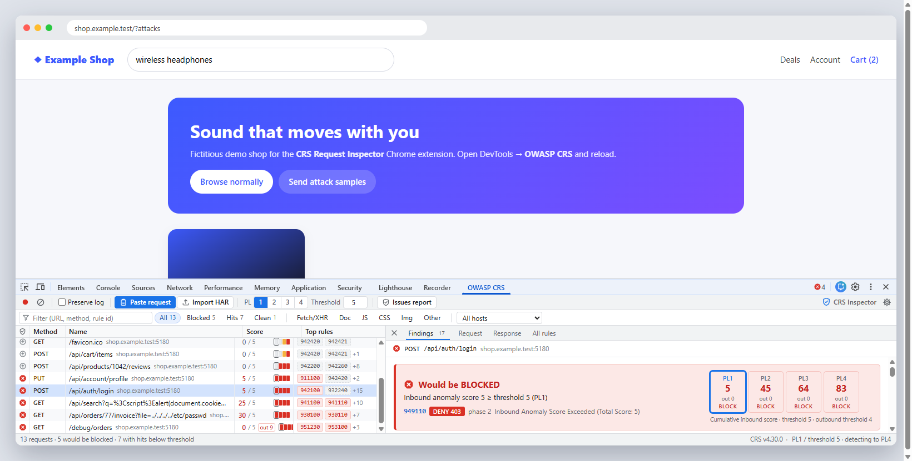

<sub>The <b>OWASP CRS</b> DevTools tab on the fictitious demo shop in <code>demo/</code>. Every request is analysed as it completes.</sub>

</div>

---

## Why?

A WAF rejects a request with **403** and you only learn about it in production. The WAF log says
`942100` and `ARGS:password`. What does that mean, and is it a real attack or a false positive?
If it's a false positive, what is the narrowest exclusion that fixes it?

CRS Request Inspector runs the **real CRS rules** against every request of your tab *while you develop*.
It runs on a JavaScript re-implementation of the ModSecurity v2 engine, so nothing leaves your browser.

## Features

| | |
|---|---|
| 🔍 **Live analysis in DevTools** | A new **OWASP CRS** tab next to *Network*. Every request is checked against the CRS when it completes, response bodies included (info-leakage rules 95x). |
| 📋 **Paste anything** | *Copy as PowerShell / cURL (bash, cmd) / fetch / Node.js fetch*, *Copy all as …*, raw HTTP and HAR files. Ctrl+V anywhere in the panel. |
| 🎯 **Exact matches** | One card per rule: request part (JSON field, query arg, cookie, header…), matched substring highlighted, transformation pipeline, operator / libinjection fingerprint, SecLang source with a link to the CRS file. |
| 📊 **Paranoia levels 1–4** | Verdict per PL in one matrix: *"passes at PL1, blocked from PL2"*. Anomaly score vs. threshold, early blocking, outbound score. |
| 🛠 **How to fix** | Per finding: likely false positive, *review*, attack payload or policy issue, plus concrete changes for the **application** and the **WAF configuration**. |
| ✂️ **Exclusion snippets** | Narrowest-first snippets for ModSecurity/Coraza (`ctl:ruleRemoveTargetById`, `SecRuleUpdateTargetById`) and Azure (Front Door JSON, Azure CLI, Terraform, Bicep, App Gateway JSON). Paste one into *Settings* to verify the fix right away. |
| ☁️ **Azure WAF simulation** | Import your WAF policy (portal JSON, `az … show`, ARM, **Terraform**, **Bicep**). The simulation covers custom rules in priority order, DRS 2.x rule availability, overrides, exclusions, and Detection vs. Prevention mode. |
| 🧾 **Issues report** | Findings across all captured traffic, grouped by rule and request part, with affected endpoints. Export as Markdown for tickets and pull requests. |
| 🔒 **Private by design** | No network access and one permission (`storage`). Rules run in a Web Worker with a watchdog. |

## Screenshots

<table>
<tr>
<td width="50%">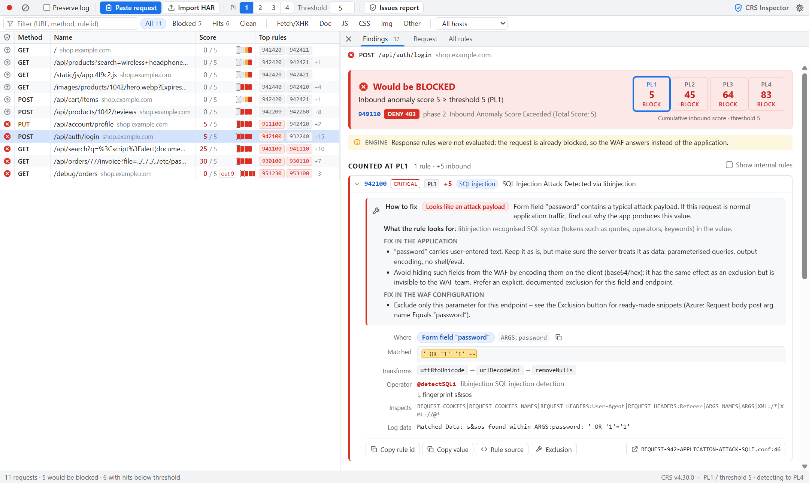<br><sub><b>Request list and verdict.</b> Scores per request, the rules that fire, and the PL1–PL4 matrix.</sub></td>
<td width="50%">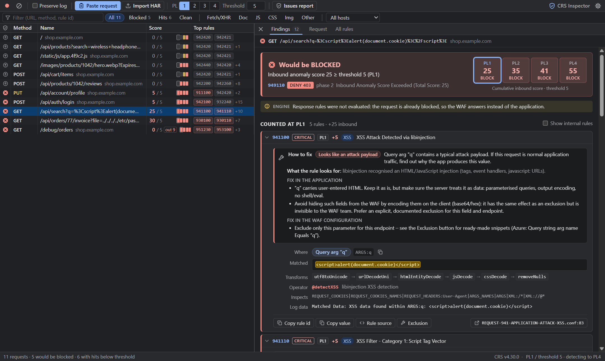<br><sub><b>Dark theme</b> follows DevTools. Here an XSS payload in a search query is blocked at PL1.</sub></td>
</tr>
<tr>
<td>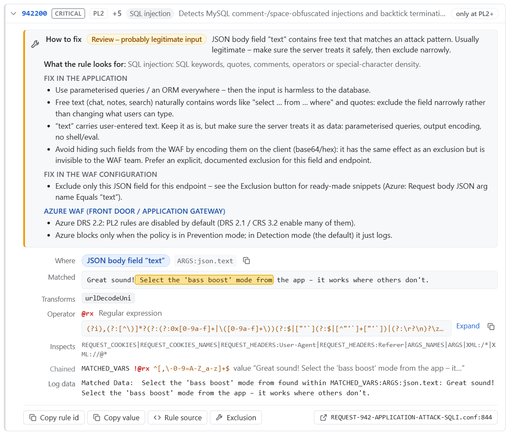<br><sub><b>How to fix.</b> A product review that trips SQLi rule 942200 only at PL2. Shows what the rule looks for and how to fix it in the app and the WAF.</sub></td>
<td>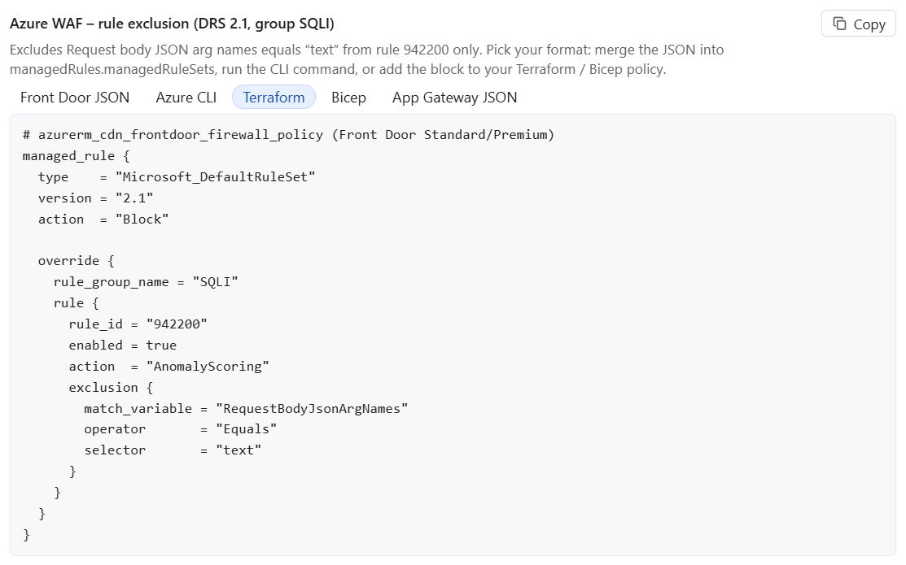<br><sub><b>Exclusion helper.</b> The narrowest exclusion for that false positive, as SecLang, Front Door JSON, Azure CLI, Terraform or Bicep.</sub></td>
</tr>
<tr>
<td>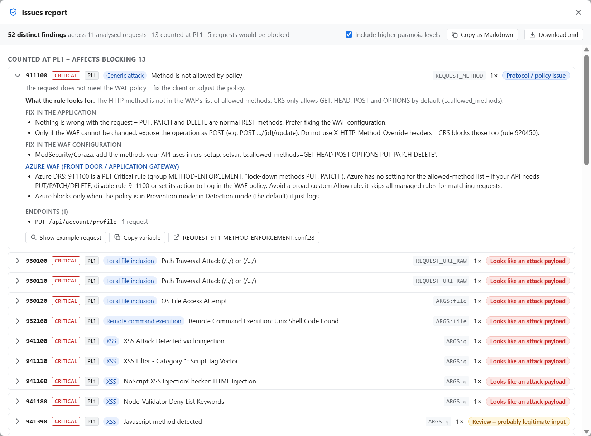<br><sub><b>Issues report.</b> All findings grouped by rule and request part, exportable as Markdown.</sub></td>
<td>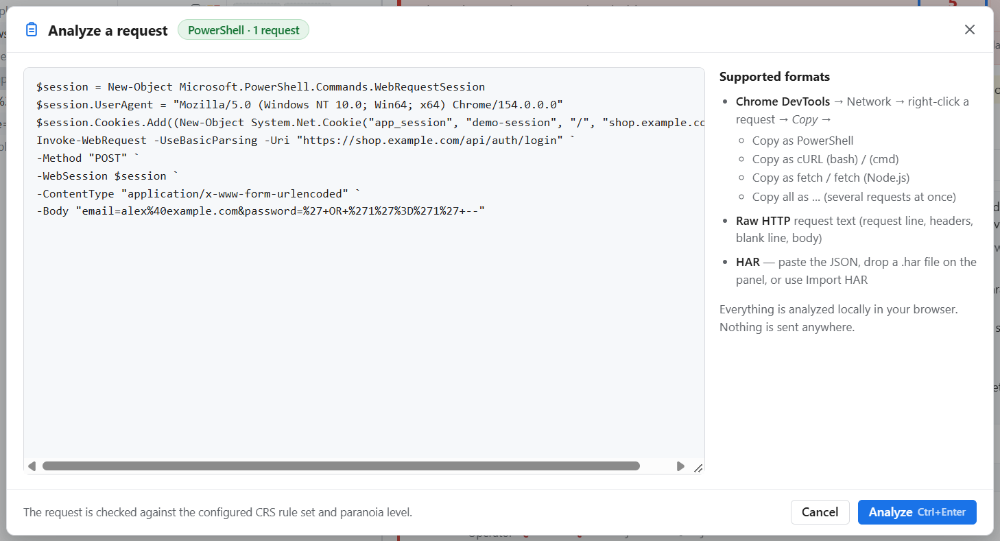<br><sub><b>Paste a request</b> copied from DevTools as PowerShell, cURL or fetch, or as raw HTTP or HAR.</sub></td>
</tr>
<tr>
<td>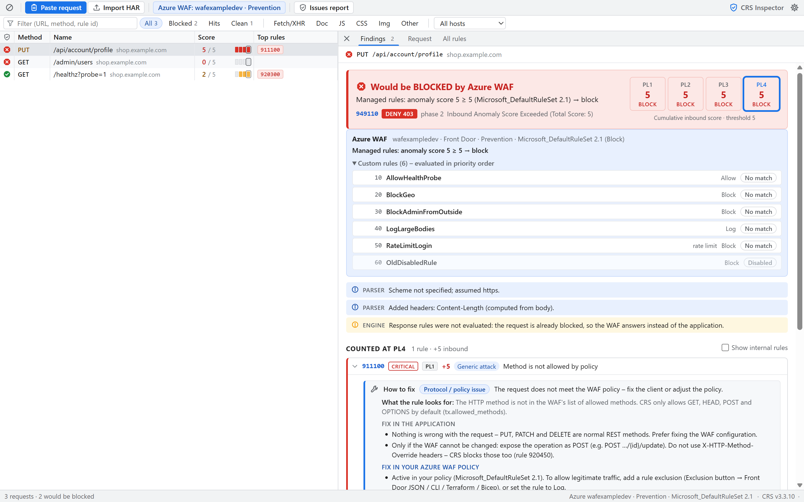<br><sub><b>Azure WAF profile.</b> A <code>PUT</code> blocked by DRS 2.1 rule 911100 in Prevention mode, simulated from an imported policy.</sub></td>
<td>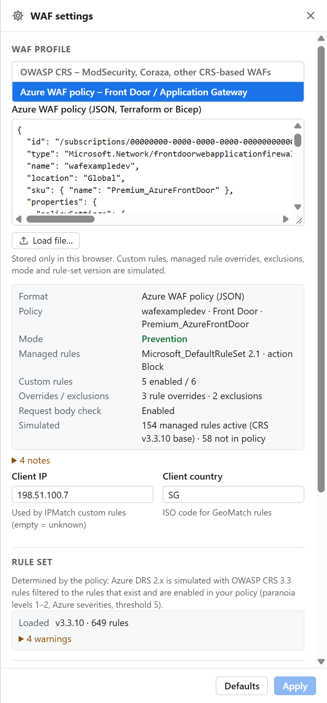<br><sub><b>Policy import.</b> Paste the Front Door / App Gateway policy as JSON, Terraform or Bicep. A summary of custom rules, overrides and exclusions appears.</sub></td>
</tr>
</table>

## Install

The extension isn't in the Chrome Web Store (yet). Load it unpacked:

1. Download or clone this repository (or unzip a release package built with `npm run package`).
2. Open `chrome://extensions` and switch on **Developer mode** (top right).
3. Click **Load unpacked** and select the **`extension/`** folder.
4. Open DevTools on any page (F12). A new tab **OWASP CRS** appears next to *Network* (maybe behind `»`).
5. Reload the page. Requests are analysed as they complete.

<p>
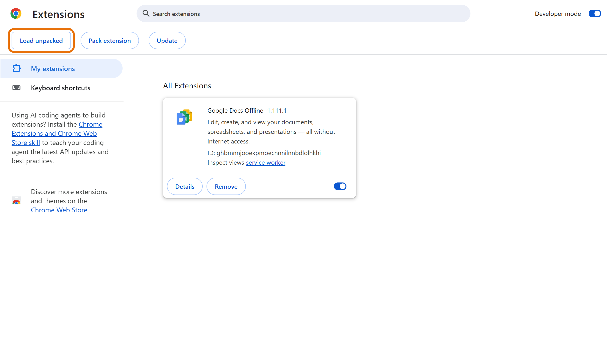
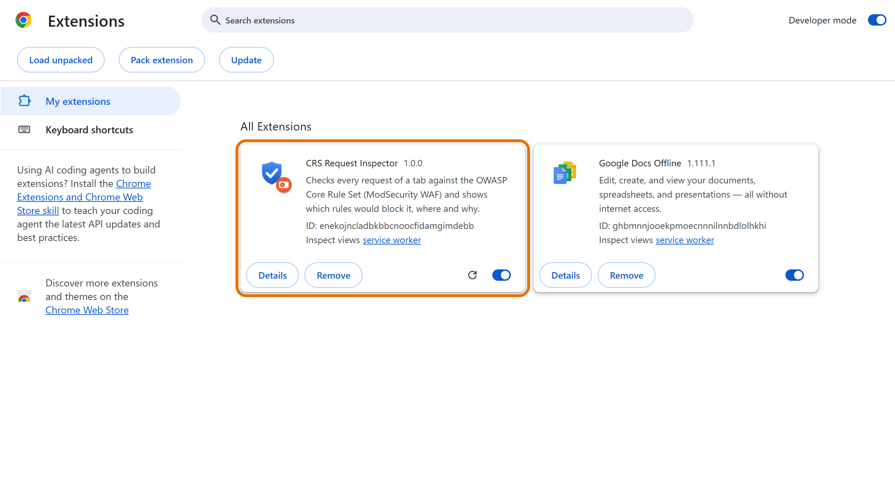
</p>

Clicking the toolbar icon opens the same UI as a normal tab, for **pasting requests without DevTools**.
Requires Chrome / Edge / Brave **125+**.

📘 **Step-by-step guide with screenshots (PDF):** [docs/CRS-Request-Inspector-Guide.pdf](docs/CRS-Request-Inspector-Guide.pdf).
It covers installation, reading the panel, paranoia levels, recommendations, exclusions and Azure WAF.

## Try it on the demo shop

The repository includes a small, fictitious online shop that sends both normal and malicious requests:

```bash
node demo/server.mjs
```

Open <http://localhost:5180>, open DevTools → **OWASP CRS**, then click **Browse normally** and
**Send attack samples**. You'll see:

* **False positives at higher paranoia levels:** signed CDN image URLs (942440 at PL2), free-text product reviews (942200 at PL2), a JWT session cookie (942420/942421 at PL3+).
* **Policy issues:** `PUT /api/account/profile` triggers 911100 because CRS only allows GET/HEAD/POST/OPTIONS by default.
* **Real attacks:** SQL injection in the login form, XSS in search, path traversal in an invoice download, and a SQL error leaked by a debug endpoint (outbound rule 951230).

## Using the panel

| Column / area | Meaning |
|---|---|
| **Status icon** | ⛔ would be blocked at your PL · ⬆ passes, but rules hit at a higher PL · ✔ clean |
| **Score** | Inbound anomaly score / threshold at the selected blocking PL (`out N` = outbound score) |
| **PL bar** | Four segments for PL1–PL4. Red means blocked at that level. |
| **Verdict** | The final decision and blocking rule (e.g. 949110), with the score at each PL |
| **Findings** | Rules counted at your PL first, then *detected at higher PL* |
| **Request tab** | The request as the WAF sees it: ARGS, flattened JSON names (`json.items.0.sku`), cookies, headers |

### Paranoia levels in one paragraph

CRS rules are grouped into **paranoia levels**. **PL1** (default) has few false positives. **PL2** adds rules
for more obfuscated attacks and will hit some legitimate input. **PL3/PL4** are strict and flag
special characters in cookies, tokens and free text. The *blocking PL* decides what counts toward the
score. The *detection PL* (default 4) shows what *would* hit if you raised the level. Every critical rule adds
5 points, and at the default threshold of **5** one critical hit blocks the request.

## WAF profiles

Pick the WAF you run in **Settings → WAF profile**.

### OWASP CRS (ModSecurity / Coraza / any CRS-based WAF)

* Bundled rule sets: **CRS v4.30.0**, **v4.25.2 (LTS)** and **v3.3.10**. Add more with `node scripts/fetch-crs.mjs vX.Y.Z`.
* Blocking/detection paranoia level, inbound/outbound thresholds, early blocking, response analysis.
* The ModSecurity *recommended* base config: JSON/XML body processors, 128 KB body limit, `REQBODY_ERROR` → 400.
* **Import your configuration:** paste `crs-setup.conf`, `REQUEST-900-EXCLUSION-RULES-BEFORE-CRS.conf`
  or `RESPONSE-999-…` content. `SecAction`/`setvar` (e.g. `tx.allowed_methods`), `SecRuleRemoveById`,
  `SecRuleUpdateTargetById` and runtime `ctl:` exclusions are all applied.

### Azure WAF (Front Door / Application Gateway)

Paste your WAF policy in any of these formats:

| Format | Where to get it |
|---|---|
| Portal / ARM JSON | Azure portal → WAF policy → *JSON view*, or *Export template* |
| Azure CLI | `az network front-door waf-policy show …` / `az network application-gateway waf-policy show …` |
| Terraform | `azurerm_cdn_frontdoor_firewall_policy`, `azurerm_frontdoor_firewall_policy`, `azurerm_web_application_firewall_policy` |
| Bicep | `Microsoft.Network/FrontDoorWebApplicationFirewallPolicies` / `ApplicationGatewayWebApplicationFirewallPolicies` |

The simulation follows the Azure order of evaluation:

1. **Custom rules** by priority: match conditions, negation, transforms, size operators, `IPMatch` / `GeoMatch`
   (client IP and country set in Settings), and the actions Allow / Block / Log / Redirect.
2. **Managed rules**: DRS 2.0 / 2.1 / 2.2. Only rules that exist and are enabled in that version run,
   with your **rule overrides** (Log / Block / Disabled), **exclusions** (global, group and rule level),
   Azure severities and the rule-set action.
3. **Policy mode**: in *Detection*, nothing is blocked and the panel says so.

Not simulated: Microsoft Threat Intelligence rules (`99xxxxxx`), Bot Manager and rate limiting.

## Accuracy

The engine (`extension/src/engine/`) is a re-implementation of ModSecurity v2 in JavaScript. It has a SecLang parser,
a PCRE → JS regex translator that works on bytes like PCRE in non-UTF mode, every transformation CRS uses,
`@pm` (Aho-Corasick), a port of libinjection 4.0.0 (`@detectSQLi`, `@detectXSS`), URL-encoded/JSON/multipart/XML
body processors, chains, `skipAfter`, `ctl:`, `setvar`, macros and anomaly scoring.

It is validated against the **official CRS regression suite** (go-ftw YAML tests, CRS CI configuration).
About **99.9 %** of the tests pass. The failures left are Apache httpd transport details (merging duplicate headers,
`Content-Length` together with `Transfer-Encoding`, a bare CR in a header) that browser traffic doesn't produce.

Known differences from a real deployment:

* Your WAF may run another engine, CRS version, exclusions or limits. Import its config to get closer.
* A rule that matches several variables adds its score once per variable (ModSecurity semantics).
* JSON arrays are flattened as `json.key.0` (Coraza style). libmodsecurity v3 uses `json.key.array_0`.
* `@rbl`, `@geoLookup` and IP reputation are not evaluated.

## How it works

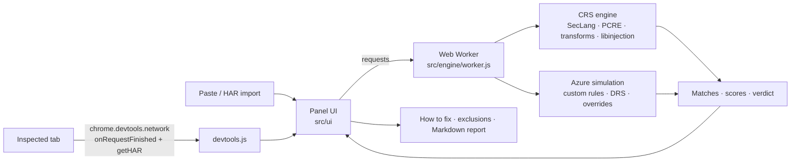

```
extension/            the unpacked extension (load this folder)
  manifest.json       MV3, devtools_page, permission: storage
  src/engine/         ModSecurity v2 re-implementation + Web Worker
  src/azure/          Azure WAF policy parser (JSON/Terraform/Bicep) and simulation
  src/ui/             panel UI (no framework), recommendations, exclusion generator
  rulesets/           bundled CRS releases + modsecurity.conf-recommended
demo/                 fictitious "Example Shop" used for screenshots and manual testing
docs/                 user guide (HTML + PDF) and README images
scripts/              tests, CRS download, packaging, screenshot automation
tests/fixtures/       sample pastes (PowerShell, cURL, fetch, HAR) and Azure policies
```

## Development

Requires Node.js 23+ (24 LTS recommended; the engine uses RegExp modifier groups like `(?i:…)`) and Chrome (for smoke tests and screenshots).

```bash
npm install                             # dev only: js-yaml for the CRS test runner
npm test                                # engine, libinjection, parsers, UI logic, recommendations, Azure
node scripts/fetch-test-data.mjs        # download CRS regression tests + libinjection test data (vendor/)
npm run test:crs                        # run the CRS regression suite against the engine
npm run serve                           # serve extension/ on http://localhost:5178
npm run test:smoke                      # headless DevTools capture smoke test (needs `serve`)
npm run package                         # dist/crs-request-inspector-<version>.zip
```

The UI also runs without Chrome APIs. Open `http://localhost:5178/panel.html?mock=1&data=demo` for the demo data.

<details>
<summary>Regenerating screenshots and the PDF guide</summary>

```bash
npm run serve &                                   # panel preview on :5178
node demo/server.mjs &                            # demo shop on :5180
node scripts/docs/capture-devtools.mjs            # docs/images/devtools.png (real DevTools, headed Chrome)
node scripts/docs/capture-install-screens.mjs     # chrome://extensions screenshots
node scripts/docs/capture-panel-screens.mjs       # guide images (docs/guide/img)
node scripts/docs/capture-azure-screens.mjs       # Azure profile images
npm run screenshots                               # README images (docs/images)
node scripts/docs/build-guide-pdf.mjs             # docs/CRS-Request-Inspector-Guide.pdf
```

Set `CHROME=/path/to/chrome` if Chrome isn't found automatically.
</details>

## Privacy

* Everything runs locally: there's no telemetry, no remote calls, and no host permissions.
* Settings (including an imported WAF policy) are stored with `chrome.storage.local` on your machine.
* Captured requests stay in memory and are gone when DevTools closes.
* **Be careful when sharing screenshots or Markdown reports.** They can contain cookies, tokens and personal data from your traffic.

## Contributing

Issues and pull requests are welcome. Please run `npm test` (and ideally `npm run test:crs`) before submitting.
Don't add real request captures to `tests/fixtures/`. Use fictitious hosts (`example.com`) and tokens.

## License & credits

This project is licensed under the [Apache License 2.0](LICENSE). See [NOTICE](NOTICE) for third-party attributions:

* [OWASP CRS](https://github.com/coreruleset/coreruleset), Apache-2.0, bundled under `extension/rulesets/<version>/`
* [ModSecurity](https://github.com/owasp-modsecurity/ModSecurity) `modsecurity.conf-recommended`, Apache-2.0
* [libinjection](https://github.com/libinjection/libinjection) (ported to JS), BSD-3-Clause, see `extension/src/engine/LICENSE.libinjection`
* Azure DRS rule metadata derived from Microsoft Learn documentation

This is an independent project. It is not affiliated with or endorsed by OWASP, the CRS project or Microsoft.
"OWASP", "ModSecurity" and "Azure" are trademarks of their respective owners.
